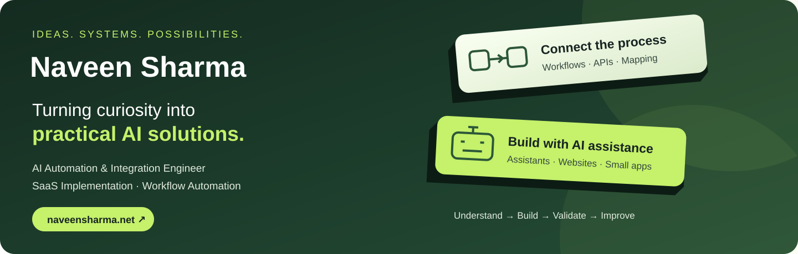
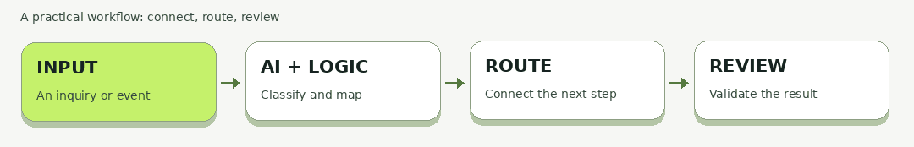

[](https://naveensharma.net/)

<div align="center">


# Naveen Sharma

### Turning curiosity into practical AI solutions.

**AI Automation & Integration Engineer · SaaS Implementation Specialist · Workflow Automation**

[](https://naveensharma.net/)
[](https://www.linkedin.com/in/naveensharmatech/)
[](https://opility.com/)

[Projects](https://naveensharma.net/#projects) · [Tools](https://naveensharma.net/#tools) · [Qualifications](https://naveensharma.net/#qualifications) · [My story](https://naveensharma.net/#about) · [Contact](https://naveensharma.net/#contact)

</div>

This repository contains the source for **[naveensharma.net](https://naveensharma.net/)**—my personal portfolio, practical demonstrations and Ella assistant. Its presentation follows the current website’s AI automation and integration direction.

## 👋 What I build

I build practical no-code workflows, AI assistants, chatbots, AI-assisted websites and small applications. My focus is understanding a process, connecting the right systems, mapping data and checking that the result works.

Technology has always made me curious. I managed a computer-training franchise and its technical operations before working in healthcare SaaS implementation. AI and no-code tools have opened a new way for me to turn that experience into useful solutions.

I contribute requirements, workflow logic, configuration, design decisions, troubleshooting and validation. AI tools help me write and refine code.



<sub>Conceptual workflow illustration. The live site provides hover depth, animated controls and reduced-motion support.</sub>

## 🧩 Projects you can inspect

| Explore | What you’ll find | Status |
| --- | --- | --- |
| [Personal portfolio & Ella](https://naveensharma.net/) | This React website, interactive demonstrations and Ella, my personal site assistant | Website available; live AI depends on provider configuration |
| [Intake & Mapping Workbench](https://naveensharma.net/intake-builder-demo) | Sample-data forms, conditional fields, validation, signatures and mapped document output | Interactive demonstration |
| [Customer Inquiry Router](https://github.com/naveensharmatech/customer-inquiry-router-zapier) | JavaScript classification, routing documentation and Gmail/HubSpot workflow examples | Reference code; external Zap inactive after trial expiry |
| [Automation & Agent Lab](https://naveensharma.net/#zapier-experiments) | Gmail acknowledgments, email-routing designs, chatbot configuration and assistant experiments | Working examples, drafts and concepts labelled individually |
| [Opility](https://opility.com/) | My venture across AI, Dev, QA and Studio, including its business website assistant Ella | Under development |
| [Array Data Transformer](https://github.com/naveensharmatech/iterative-array-data-transformer) | A proposed approach to normalizing records and transforming payloads | Concept; executable implementation not yet published |

The site also documents B2B and Shopify extraction projects, academic work and QA learning materials. Workflow-reference graphics are learning references, not claims that I built or deployed those workflows.

## 🤖 Ella — my personal site assistant

Ella helps visitors explore my experience, projects and learning, and discuss AI, automation and related questions. The React interface calls a Cloudflare Pages Function. The server uses relevant public site knowledge and a configured AI provider; if that connection is unavailable, it returns a clearly labelled saved-knowledge answer.

Ella is part of this codebase, not a separate repository. The assistant on Opility uses its own business context.

## 🛠️ Tools behind the work

<p align="center">
  
  
  
  
  
  
  
  
  
  
  
</p>

| Area | Tools and focus |
| --- | --- |
| Workflow automation | Zapier, Make, n8n; triggers, branching, routing and handoffs |
| AI-assisted building | ChatGPT/Codex, Claude, Gemini and Google AI Studio |
| Integration work | REST APIs, webhooks, JSON, field mapping, HubSpot and Postman |
| Websites and delivery | React, Vite, GitHub and Cloudflare Pages |
| Continuing development | Make, n8n, CRM platforms, assistants, agents and API testing |

These tools reflect a mix of project use and ongoing learning. Code-based builds are AI-assisted; tool logos do not imply expert-level proficiency.

## ✨ Inside the current website

- Responsive layouts, system light/dark preferences and keyboard navigation.
- Green dimensional navigation, icons, card hover motion and reduced-motion alternatives.
- Standalone demonstrations and certificate pages using the shared portfolio theme.
- Project descriptions with links to source code, demonstrations and supporting documents.
- Interactive sample-data workbenches for forms, field mapping and document workflows.
- Experience, qualifications, certificate evidence, résumé links and my personal story.
- An automation learning gallery and experiments with their individual development status.
- Ella’s chat interface, server-side handler and public knowledge source.

## 🗂️ Where the current code lives

| Path | Purpose |
| --- | --- |
| [src/App.jsx](src/App.jsx) | Main page, current headline, sections, projects and experience |
| [src/RestoredContent.jsx](src/RestoredContent.jsx) | Ella interface, additional content, experiments and workflow gallery |
| [src/index.css](src/index.css) | Website styling and theme rules |
| [functions/api/chat.js](functions/api/chat.js) | Ella’s server-side request handler and fallback |
| [data/ella-knowledge.js](data/ella-knowledge.js) | Public knowledge used by Ella |
| [public/](public/) | Active images, tool logos, demonstrations and public documents |
| [public/portfolio-theme.css](public/portfolio-theme.css) | Green styling, readable type and reduced-motion support for standalone pages |
| [archive/](archive/) | Retired implementations and media; excluded from the live build |
| [docs/CUSTOMIZATION.md](docs/CUSTOMIZATION.md) | How to update content, Ella, CV files and visuals together |
| [tests/](tests/) | Chat-handler tests and browser acceptance scenarios |

The README describes the application; it does not generate the website. An older README or release note does not mean the site’s current code is missing.

## 🚀 Run locally

Use **Node.js 22.12+** and npm.

```bash
npm ci
npm run dev
```

Build and check:

```bash
npm run build
npm run test:chat
npm run check:content
npx playwright install chromium
npm run test:acceptance
```

`npm run preview` serves the static build from `dist/`. It does not run Cloudflare Pages Functions. See the [deployment guide](docs/DEPLOYMENT.md) to test Ella’s endpoint in a Pages-compatible environment. Live AI requires the server-side `GROQ_API_KEY`; never place it in browser code or a `VITE_*` variable.

Test files and past passing runs are not a guarantee that every current integration or device has been verified. See [validation coverage](MOBILE_OPTIMIZATION.md). The [October release record](DEPLOYMENT_COMPLETED.md) is historical evidence for its named commit, not the current deployment status.

## 🎓 Background and learning

My paid SaaS work involved healthcare intake configuration, conditional forms, JSON/data mapping, document generation, eSignature routing and workflow validation. That experience supports my current automation direction.

Completed Zapier Academy paths: **AI Builder · MCP · Account Admin Essentials**. I’m continuing practical learning across Make, n8n, CRM tools, AI platforms and API testing. [Explore qualifications](https://naveensharma.net/#qualifications).

## 📬 Let’s connect

Open to AI/workflow automation, implementation and integration opportunities, remote work that can hire in Israel, and freelance projects.

[Contact Naveen](https://naveensharma.net/#contact) · [LinkedIn](https://www.linkedin.com/in/naveensharmatech/) · [Business enquiries](https://opility.com/contact)

## Visuals and maintenance

The banner and animated workflow are repository-hosted assets. GitHub displays image animation; website CSS/JavaScript and interactive 3D run on the actual site. All essential information remains available as text.

Use the [customization guide](docs/CUSTOMIZATION.md) for the exact source files. Update public biography in the site, Ella and both résumé formats together. Original academic documents and certificates remain original evidence. Historical release notes apply only to their named commits.
